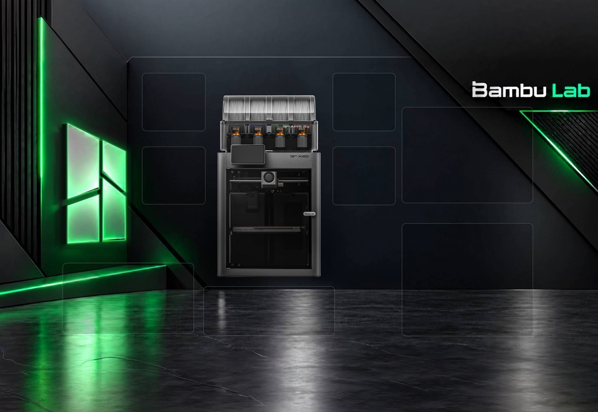

# Bambu Lab X2D – Home Assistant dashboard (Swedish)

A YAML dashboard with a background image of the printer and live values overlaid
(temperatures, AMS 2 Pro, slots, fans, print status, camera). Designed for
the Bambu Lab X2D with AMS 2 Pro. Read-only, except for the light button.

The dashboard labels are in Swedish. These instructions are in English.



## Files

| File | Purpose |
| --- | --- |
| `x2d.yaml` | Home Assistant dashboard configuration. |
| `configuration-snippet.yaml` | Registers the dashboard under `lovelace:`. |
| `Bambu_Lab_X2D_Home_Assistant_EN.txt` | English instructions as a text file. |
| `images/bakgrund_v2_1920.jpg` | Matching v2 background used by the dashboard. |
| `images/background-preview.jpg` | Earlier background image, kept for reference. |

## Background image

The matching v2 background is included as `images/bakgrund_v2_1920.jpg`.
The supplied file is **1536 × 1060 pixels**, a downscaled version with the
same layout proportions as the 3840 × 2651 reference described in `x2d.yaml`.
The dashboard uses percentage-based positions. Keep the filename unchanged
when copying the image into Home Assistant; it matches the dashboard's image path.

The earlier, wider image is kept as `images/background-preview.jpg` for
reference. Use `bakgrund_v2_1920.jpg` for installation.

Printer product imagery: Bambu Lab.

## Requirements

- Bambu Lab integration (`bambu_lab`), tested with version 2.2.26.
- **card-mod** via HACS (used for all styling).
- The printer must be set to LAN Only Liveview for the camera feed (configured on the printer).
- The printer does not need to be in Developer LAN mode, since the dashboard does not control the printer.
- The YAML includes `kiosk_mode:` settings for hiding the header and sidebar.
  Use **kiosk-mode** if you want those settings, or remove that section if you do not use it.
- Some filament weight and percentage labels reference optional Spoolman sensors:
  `sensor.spoolman_ams_fack_<slot>_kvar` and
  `sensor.spoolman_ams_fack_<slot>_procent`. Adjust these references to match your setup.

## Installation

1. Copy `images/bakgrund_v2_1920.jpg` into `/config/www/X2D/`.
   Keep its name as `bakgrund_v2_1920.jpg`. The dashboard loads it from
   `/local/X2D/bakgrund_v2_1920.jpg?v=1`.
2. Copy `x2d.yaml` to `/config/dashboards/x2d.yaml`.
3. Merge `configuration-snippet.yaml` into `configuration.yaml`:

   ```yaml
   lovelace:
     dashboards:
       x2d-dashboard:
         mode: yaml
         title: X2D
         icon: mdi:printer-3d
         show_in_sidebar: true
         require_admin: false
         filename: dashboards/x2d.yaml
   ```

   If `lovelace:` already exists, merge the `dashboards:` entry into it
   instead of adding a second `lovelace:` key.
4. Restart Home Assistant and open X2D from the sidebar. For an already
   registered dashboard, reload the dashboard after editing its YAML.

## Change entity names

All entities in the file are named `sensor.sovrum_x2d_*`, `binary_sensor.sovrum_*`,
`image.sovrum_*`, `camera.sovrum_x2d_camera`, and similar. `sovrum` is the name
of our printer. Replace the prefix with your own printer name, for example
`sovrum_` → `verkstad_`, or use find and replace in an editor.

For AMS 2 Pro: replace `sovrum_ams_2_pro_` with your own AMS prefix. Check
each entity under Developer tools → States before you begin.

The optional Spoolman entity names use a separate naming scheme and need to
be adjusted separately.

## Customize the layout

All positions are expressed as percentages of the image's width and height.
If you change the background, remeasure the positions of the eight main panels
and the printer, then adjust `left`/`top`, element sizes, and the background
aspect-ratio calculations as needed. The comments in the file identify each panel.
